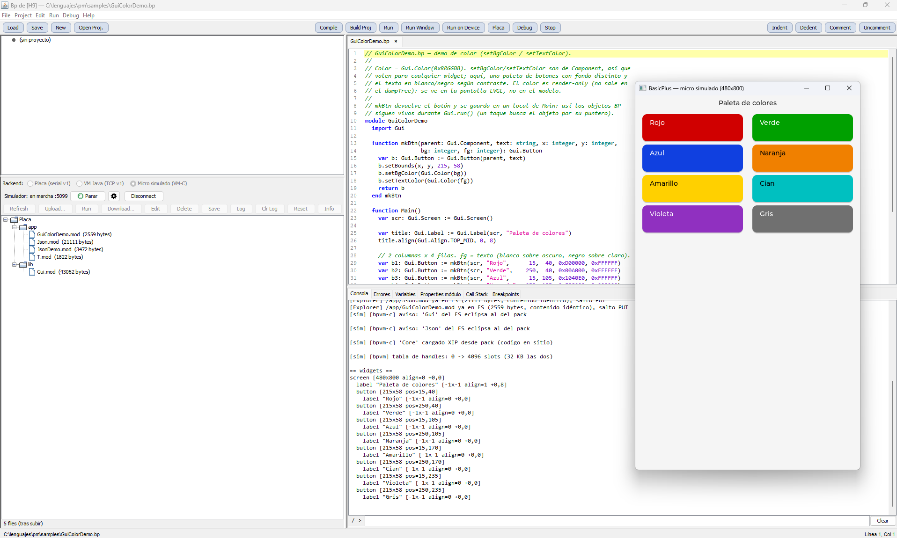

# BasicPlus

**BASIC orientado a objetos para microcontroladores de 32 bits.** Escribes y
depuras el programa en el PC; el mismo bytecode corre después, byte a byte, en
una Raspberry Pi Pico 2, un ESP32 o un STM32 — sin recompilar, sin `#ifdef`.

[](https://github.com/micro32-suite/BasicPlus/releases/latest)
[](LICENSE)
[](https://micro32-suite.github.io/BasicPlus/pruebas.html)
[](https://micro32-suite.github.io/BasicPlus/)

**[⬇️ Descarga para Windows](https://github.com/micro32-suite/BasicPlus/releases/latest)** ·
**[📖 Documentación](https://micro32-suite.github.io/BasicPlus/)** ·
**[🚀 Inicio rápido](docs/QUICKSTART.md)** ·
🇬🇧 **[English version](README.md)**



*El IDE con el ejemplo `GuiColorDemo` y, a la derecha, el micro simulado
ejecutándolo: el mismo bytecode pinta la pantalla de una placa.*

```basic
// blink.bp — parpadea el LED de la Pico (GP25)
module Blink
  import Gpio

  function Main()
    var led: Gpio.Pin := Gpio.Pin(25, Gpio.Pin.OUTPUT)
    var i: integer := 0
    while i < 10 do
      led.on()
      sleep(300)
      led.off()
      sleep(300)
      i := i + 1
    endwh
    print "Blink terminado"
  end Main
end Blink
```

En un PC, sin GPIO, las llamadas al hardware se escriben en la consola; en la
placa mueven pines de verdad. El programa es el mismo byte a byte.

<details>
<summary>El mismo programa en <b>JC</b>, para quien viene de Java o de C#</summary>

```java jc
// blink.jc — el mismo programa en JC
module Blink
{
   import Gpio;

   function void Main()
   {
      Gpio.Pin led = new Gpio.Pin(25, Gpio.Pin.OUTPUT);
      for (int i = 1; i <= 10; i++)
      {
         led.on();
         sleep(300);
         led.off();
         sleep(300);
      }
      println("Blink terminado");
   }
}
```

El mismo compilador, el mismo bytecode, la misma salida; el IDE traduce un
programa de una sintaxis a la otra.

</details>

## Pruébalo (Windows, sin compilar nada)

1. Ten instalado **Java 8 o posterior**.
2. Descarga **`Micro32-Suite-8.1-win.zip`** de la
   [última versión](https://github.com/micro32-suite/BasicPlus/releases/latest)
   y descomprímelo donde quieras.
3. Ejecuta **`bpide.bat`**. Abre `samples/blink.bp`, pulsa **Compile** y
   después **Run**: la salida aparece en la consola. Para la interfaz gráfica,
   lo mismo con `samples/GuiColorDemo.bp`, con **Run Window**.

Para empezar no hace falta placa. Cuando la tengas, el ZIP trae también las
nueve imágenes de firmware y los packs: **[Instalar el
firmware](docs/INSTALAR_FIRMWARE.md)** dice qué grabar en cada placa, y
**Run on Device** hace el resto. En Linux o macOS, [compílalo desde el
código](#compilar-desde-el-código).

## Por qué BasicPlus

- **Depura en el PC, despliega en el micro.** Dos máquinas virtuales
  independientes, una en Java y otra en C99, ejecutan el mismo bytecode, y la
  salida de un programa tiene que ser byte a byte la misma en las dos. Cada
  novedad se verifica contra eso antes de entrar.
- **Sencillo de leer, sin tratarte como a un principiante**: clases y
  herencia, interfaces y genéricos, excepciones, módulos, tuplas, properties; e
  hilos — en las placas de dos núcleos, dos de ellos corren a la vez de verdad.
- **El hardware es una clase**: `Gpio`, `I2c`, `Spi`, `Uart`, `Pwm`, `Adc`,
  `Neopixel`… (`Gpio.Pin`, `I2c.Bus`, `Net.Tcp`), y lo que un programa toma se
  suelta al acabar. **SQLite**, con su ORM, va como pack.
- **Interfaz gráfica en la placa**: LVGL, con una veintena de widgets,
  pantallas diseñadas en un fichero JSON, y táctil. En el PC, el mismo programa
  pinta una ventana.
- **WiFi y Bluetooth** en las ESP32 con PSRAM: el IDE sube, graba y ejecuta por
  la red; del Bluetooth, el teclado y el ratón.
- **Código nativo donde cuenta**: una `native function` se compila por
  adelantado a Thumb-2 o RISC-V y viaja dentro del fichero de bytecode —
  40-90× sobre el intérprete en kernels de cómputo.
- **Dos sintaxis, un compilador**: BasicPlus, y **JC** para quien viene de
  Java o de C#.
- **Probado en hardware real**: la ronda de pruebas de V8 pasó en las once
  placas, y cuatro de ellas corrieron 48 horas seguidas un programa que lo toca
  todo, sin un error ni un reinicio. Todas las pruebas, con sus números, en
  **[Cómo se prueba BasicPlus](https://micro32-suite.github.io/BasicPlus/pruebas.html)**.

## Placas

Nueve imágenes de firmware, once placas, tres arquitecturas — y el PC
(Windows, Linux o macOS), que ejecuta las dos VMs y enseña la interfaz gráfica
en una ventana.

| Placa | Chip | Pantalla (LVGL) | WiFi · Bluetooth | `native` (AOT) |
|---|---|---|---|---|
| Raspberry Pi **Pico 2** (y 2 W) · Adafruit **Metro RP2350** | RP2350 — Cortex-M33, 2 núcleos | — | — | Thumb-2 |
| **ESP32-S3** DevKitC | ESP32-S3 — Xtensa, 2 núcleos | — | ✅ | interpretado |
| Placa **ESP32-C3** | ESP32-C3 — RISC-V | — | — | RISC-V |
| Waveshare **ESP32-C6-LCD-1.3** | ESP32-C6 — RISC-V | 240×240, SPI | — | RISC-V |
| Waveshare **ESP32-C5-Touch-LCD-2.8** | ESP32-C5 — RISC-V | 240×320, SPI, táctil | ✅ | RISC-V |
| Waveshare **ESP32-P4** 4,3" | ESP32-P4 — RISC-V, 2 núcleos | 480×800, MIPI-DSI, táctil | ✅ (por su ESP32-C6) | RISC-V |
| Espressif **ESP32-P4-Function-EV** · **ESP32-P4X-Function-EV** | ESP32-P4 · P4X — RISC-V, 2 núcleos | 1024×600, MIPI-DSI, táctil | sin probar | RISC-V |
| ST **Nucleo-U575ZI-Q** | STM32U575 — Cortex-M33 | — | — | Thumb-2 |
| ST **Discovery STM32U5G9J-DK2** | STM32U5G9 — Cortex-M33 | 800×480, LTDC, táctil | — | Thumb-2 |

La WiFi y el Bluetooth piden PSRAM, y la C3 y la C6 no la tienen. Los buses se
validaron con sensores reales en las tres familias sin pantalla —un BMP280 y
un BME280 por I2C, un BME688 por SPI, loopbacks de UART—, y en la Pico 2 el
PWM, contado por hardware, con menos de un 0,1 % de error. Cómo se graba, la
configuración de la placa y los packs que pide cada una: **[Instalar el
firmware](docs/INSTALAR_FIRMWARE.md)**; los primeros pasos, placa a placa:
**[Inicio rápido](docs/QUICKSTART.md)**.

## Cómo funciona

El compilador convierte un `.bp` (o un `.jc`) en un `.mod`: el bytecode, la
interfaz del módulo para el `import` y, dentro, el código nativo de sus
funciones `native` — un fichero por módulo. Ese fichero lo ejecutan **dos
máquinas virtuales independientes**:

| VM | Lenguaje | Dónde corre |
|---|---|---|
| **miVM** | Java | El PC: desarrollo, depuración, las pruebas |
| **bpgenvm-c** | C99 | También el PC, y el firmware de las placas |

La regla de oro del proyecto: **la salida de un programa debe ser byte a byte
la misma en las dos VMs**. Cada novedad se hace primero en Java, después en C
—con su salida comparada byte a byte con la de Java—, y sólo entonces pasa a
las placas. Es lo que hace que "depura en el PC, despliega en el micro" no sea
un eslogan.

## El lenguaje

- **Orientación a objetos completa**: clases con constructores y destructor
  (`~Clase()`), herencia (también entre módulos), interfaces, genéricos,
  `instanceof`, properties con `get`/`set`, properties `sync` (atómicas),
  miembros estáticos. Las clases raíz (`Object`, `Thread`, `Mutex`,
  `StringBuilder`) están escritas en el propio BasicPlus, en `Core`.
- **Tipos**: `integer`, `long` (i64), `float`, `double`, `boolean`, `string`
  (UTF-8 nativo, indexado por codepoints), tipos estrechos (`byte`, `word`,
  `short`, `int8`, `int16`), arrays (`integer[]`, `byte[]`, `long[]`, …) y
  arrays de tamaño fijo (`var buf: byte[64]`), en una función o dentro de un
  objeto.
- **Tuplas** first-class (`(integer, string)`), **parámetros con valor por
  defecto**, operadores compuestos y el ternario (`iif`), expresiones
  multilínea, `switch/case`.
- **Excepciones**: `try/catch/finally`, jerarquía con base común `Exception`,
  los errores de la VM con su tipo (`ArithmeticError`, `IndexError`…), clases
  de excepción propias — también entre módulos.
- **Concurrencia**: hilos BP sobre un scheduler de quanta —en las placas de
  dos núcleos, dos de ellos a la vez de verdad, uno por núcleo—, `Mutex`,
  `synchronized`, colas `SyncList` con consumo bloqueante.
- **Módulos** (modelo DEFINITION de Modula-2): `import` resuelve contra la
  interfaz compilada del módulo, que viaja dentro del propio `.mod`.
- **`native function`**: compilada por adelantado a Thumb-2 (RP2350, STM32) o
  RISC-V (ESP32-P4, C3, C5 y C6), con los faults propagados al `try/catch` de
  BP. Dentro, casi todo el lenguaje: cualquier builtin, llamadas a BP,
  `try/catch/finally`; y una larga cede a los demás hilos y se para con Stop.
- **Interfaz gráfica**: el módulo `Gui` sobre **LVGL** — ~20 widgets OO,
  formularios diseñados en JSON (`.win`), color y fuentes, táctil. Desde V7,
  LVGL va en un **pack** que se graba en la placa: la que no tiene pantalla no
  lo paga.
- **Biblioteca estándar**: `Core`, `Math`, `IO` (ficheros con `IO.File` e
  `IO.TextFile`, prompt), `Str`, `Collections` (con un `Map` tipado), `Stats`,
  `Compress` (LZSS), `Log`, `Json`, `Net` (cliente TCP), `Air` (la WiFi y el
  Bluetooth), `App`, `Packs`, `Machine` (id del chip, temperatura, reloj,
  reset), `Time` (fechas), `Heap` (memoria) y el zoo de hardware: `Gpio`,
  `I2c`, `Spi`, `Uart`, `Pwm`, `Adc`, `Rtc`, `Wdt`, `Timer`, `Pulse`, `Freq`,
  `Neopixel`.

Todo el lenguaje, en el **[manual](https://micro32-suite.github.io/BasicPlus/manual.html)**;
lo que aún no hace, dicho sin adornos, en las
[limitaciones conocidas](docs/PENDIENTES.md).

## El IDE y la placa

`BpIde` es un único jar (Swing): editor con pestañas y diagnósticos, Run y
Debug en el PC o dentro de la placa —breakpoints y paso a paso en los dos—, y
un explorador de la placa con sus ficheros, su consola (`dir`, `run`, `kill`,
`autorun`, `log`, …) y su gestión: las particiones, el entorno de la placa y
el panel de **Packs**, desde el que se graban la pantalla, SQLite o la
biblioteca estándar. Llega a la placa por cable o, en las que tienen WiFi, por
la red. Y cuando no hay placa a mano, un **micro simulado**, con su pantalla.

En la placa, **Stop** para un programa sin resetearla, y el **autorun**
(`/sys/auto.txt`) arranca tu programa al encender —un dispositivo autónomo de
verdad—; el IDE puede conectarse después y recuperar el control. El cable
tiene su propio hilo de SO, aparte del programa: el IDE sigue hablando con la
placa mientras un programa corre.

## Compilar desde el código

Requisitos: JDK 8+, Maven, GCC (MinGW en Windows), `make`.

```sh
# 0. Clonarlo CON sus submódulos (toolchain/ y bpgenvm-c/); si ya lo clonaste
#    sin ellos: git submodule update --init
git clone --recursive https://github.com/micro32-suite/BasicPlus.git
cd BasicPlus

# 1. Toolchain Java (el formato de los packs, la VM Java y el compilador), en este orden
mvn -f toolchain/pack/pom.xml install
mvn -f toolchain/miVM/pom.xml install
mvn -f toolchain/lexer-java/pom.xml install

# 2. VM C de host  (añade LVGL=1 para la ventana de la GUI; ver bpgenvm-c/README)
cd bpgenvm-c && make && cd ..

# 3. Compilar y ejecutar un ejemplo en AMBAS VMs
java -jar toolchain/lexer-java/target/basicplus-frontend.jar samples/blink.bp \
     --compile samples --backend=mivm
java -jar toolchain/miVM/target/bpgenvm-1.0.jar samples/Blink.mod
bpgenvm-c/build/bpgenvm-c --libdir=bpstdlib samples/Blink.mod

# 4. (Opcional) el IDE
mvn -f toolchain/BpIde/pom.xml package
java -jar toolchain/BpIde/target/BpIde-8.1.jar
```

Los firmwares se compilan con sus toolchains habituales (pico-sdk + ninja,
ESP-IDF, STM32CubeIDE); ver `bpgenvm-c/{pico,esp32,esp32c3,esp32c5,esp32c6,esp32p4,stm32}/`.
Los packs de la GUI (`Gui`, `GuiMini`, `DriverSpi`) se construyen desde
`bpstdlib/gui/` (cada `.bpbuild` dice cómo). O coge los **binarios
precompilados** —imágenes y packs— de la [última versión](https://github.com/micro32-suite/BasicPlus/releases/latest).

## Estructura del repositorio

Desde la V8.1 el proyecto es una suite de tres repositorios en la organización
[micro32-suite](https://github.com/micro32-suite): éste,
[toolchain](https://github.com/micro32-suite/toolchain) (lo de Java) y
[runtime](https://github.com/micro32-suite/runtime) (lo de C), que éste trae
como submódulos.

```
toolchain/    lo de Java — submódulo: micro32-suite/toolchain
  pack/         el formato de los packs
  miVM/         VM Java + debugger + daemon TCP
  lexer-java/   compilador de BP y JC: .bp/.jc → .mod + .dbg (el código nativo va dentro del .mod)
  BpIde/        IDE Swing (fat-jar)
bpgenvm-c/    VM C99: host + firmwares de RP2350, ESP32-S3/C3/C5/C6/P4, STM32
              — submódulo: micro32-suite/runtime
bpstdlib/     biblioteca estándar (fuentes .bp + .mod compilados); los packs de la GUI, en gui/
packs/        los packs; en el repo, sólo Stdlib.pack (los demás se construyen o vienen en la release)
samples/      programas de ejemplo
compat/       la red de pruebas: la paridad dual-VM, los formatos viejos, la de resistencia
scripts/      el empaquetador, los generadores y las herramientas de los documentos y el corpus
docs/         manual, guía gráfica, specs (.mod, opcodes, heap, wire), backlog
```

## Documentación

En **español** y en **[inglés](README.md)**, también en la
**[web](https://micro32-suite.github.io/BasicPlus/)**.

- **[Inicio rápido](docs/QUICKSTART.md)** — de cero a blink, por plataforma.
- **[Instalar el firmware](docs/INSTALAR_FIRMWARE.md)** — flashear la VM en
  cada micro (imagen precompilada o compilada por ti), y los packs que pide
  una placa con pantalla.
- **[Manual del lenguaje](https://micro32-suite.github.io/BasicPlus/manual.html)** —
  léxico, tipos, clases, módulos, excepciones, concurrencia.
- **[JC, BasicPlus con llaves](https://micro32-suite.github.io/BasicPlus/jc.html)** —
  la sintaxis de Java y C# sobre el mismo compilador y el mismo bytecode: cada
  construcción, en JC y en BP, y cómo traducir de uno a otro.
- **[Referencia](https://micro32-suite.github.io/BasicPlus/referencia.html)** —
  biblioteca estándar completa, línea de comandos y artefactos en disco.
- **[Guía de interfaz gráfica](https://micro32-suite.github.io/BasicPlus/gui.html)** —
  el módulo `Gui`: widgets, color y fuentes, formularios (`.win`), ejecución
  en host y placa.
- **[Guía del IDE](https://micro32-suite.github.io/BasicPlus/guia-ide.html)** —
  la ventana, proyectos, Run/Stop, el explorador de la placa, la consola del
  micro y el depurador.
- **[Cómo se prueba BasicPlus](https://micro32-suite.github.io/BasicPlus/pruebas.html)** —
  todas las pruebas que pasa cada versión, en el PC y en las placas, con sus
  números y los fallos que cazaron.
- **[BasicPlus desde dentro](https://micro32-suite.github.io/BasicPlus/bp-desde-dentro.html)** —
  la arquitectura: compilador, bytecode, las dos VMs, GC, AOT y firmwares.
- [Filosofía del proyecto](docs/PHILOSOPHY.md) — qué es y qué no quiere ser.
- Especificaciones: [formato .mod](docs/MOD_FORMAT.md),
  [opcodes](docs/OPCODES.md), [layout del heap](docs/HEAP_LAYOUT.md),
  [builtins](docs/BUILTINS.md), [protocolo wire](docs/BPVM_WIRE_PROTOCOL.md).

## Estado

**Versión 8.1** (noviembre 2026). La V1 demostró la idea; la V2 la endureció y
la amplió; la V3 le puso cara; la V4 le arregló los cimientos; la V5 le dio
dónde guardar cosas; la V6 puso orden en el código de los microcontroladores;
la V7 dejó una imagen por micro; **la V8 lo conecta**: la WiFi y el Bluetooth,
JC y una placa más, la ESP32-P4X. La V8.1 no cambió nada del producto:
reorganizó el proyecto como una suite.

Cada versión, en las [releases](https://github.com/micro32-suite/BasicPlus/releases)
y en las [notas de versión](docs/RELEASES.md).

## Comentarios

Preguntas, ideas o un fallo: [abre una issue](https://github.com/micro32-suite/BasicPlus/issues)
o [una discusión](https://github.com/micro32-suite/BasicPlus/discussions), en
español o en inglés.

## El nombre (y una deuda de gratitud)

BasicPlus toma su nombre del **BASIC-PLUS de Digital Equipment Corporation**,
el dialecto estructurado de BASIC que corría bajo RSTS/E en los PDP-11 durante
los años 70 y 80. Aquel lenguaje demostró que un BASIC podía ser serio: con él
se escribieron sistemas completos, y con él aprendió a programar una
generación. Este proyecto es un homenaje a esa idea — **un lenguaje sencillo
de leer que no te trata como a un principiante** — trasplantada al hardware
pequeño de hoy: los microcontroladores de 32 bits.

## Licencia

[MIT](LICENSE). Hecho con cariño, placas en la mesa y memoria de los
PDP-11.
