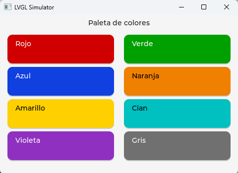

# BasicPlus

> 🇪🇸 [Versión en español](README.es.md)

**A general-purpose language for 32-bit microcontrollers, with modern BASIC
syntax, object orientation, a graphical UI and a first-class debugger.**

It compiles to bytecode (`.mod`) that runs **identically** on the PC and on
the micro: the same program you debug on your desktop later blinks an LED on
a Raspberry Pi Pico 2, an ESP32 (S3, C3, C5, C6 or P4) or an STM32 — no
recompiling, no `#ifdef`, no surprises.

```basic
// blink.bp — blinks the Pico on-board LED (GP25) using the OO API.
module Blink
  import Gpio

  function Main()
    var led: Gpio.Pin := Gpio.Pin(25, Gpio.Pin.OUTPUT)
    var i: integer := 0
    while i < 100 do
      led.on()
      sleep(300)
      led.off()
      sleep(300)
      i := i + 1
    endwh
    print "Blink done"
  end Main
end Blink
```

On a PC with no GPIO the hardware builtins log to stdout; on the board they
drive real pins. The program is the same, byte for byte.

## New in V7

V7 centres on three things:

- **Packs: one image per micro.** The pack zone is a fixed area of the flash
  where packs are burned and used in place, without being loaded into RAM. It
  started with modules, then native code — SQLite was the first big win — and
  V7 extends it to **LVGL**, the engine behind the graphical interface, which
  no firmware image carries any more. There is one image per micro,
  and **you** decide whether to add SQLite and the screen, without building
  images or compiling any C: you burn the pack from the IDE (*Placa* →
  *Packs*).
- **Finishing what was pending** — a huge number of items. Among them, native
  functions: the cases that could not be turned into `native` are practically
  down to zero. A `native` can call any builtin, yield, be stopped with Stop
  and hold a `try`/`catch`/`finally`; and on the **ESP32-C3, C5 and C6**
  (RISC-V without FPU) it is now compiled and accelerated too.
- **The second core.** On the dual-core boards — Pico 2, Metro, S3 and P4 —
  two BP threads run at the same time. With two threads working at once, the
  ESP32-P4 reaches 200 % of one core's performance (133 % on strings), and the
  RP2350 between 113 % (Metro) and 168 % (Pico 2). A known limitation, left
  for V8: on the RP2350 the dual-core image slows down a single-threaded
  program (by up to 35 % on the Metro), and strings don't scale there with two
  threads.

And what you'll notice: a new board, the **ESP32-C5** (Waveshare
ESP32-C5-Touch-LCD-2.8: a 2.8" touch screen, 8 MB of PSRAM, 32 MB of flash and
a TF slot); **destructors** (`function ~Class()`), and when a program ends —
normally, with an error or with a Stop — its objects are destroyed and each one
releases what it took: a PWM stops, the outputs go back to their reset state;
`import Core` is implicit; the new `Time` (dates) and `Heap` (memory) modules,
and `IO.File`; and while a program runs, the IDE can list and read the board's
files.

Upgrading from V6: flash the V7 image, burn the V7 packs (the ABI of native
code changed) and recompile your programs and libraries (the `.mod` format is
now MOD9). Full detail in the **[release notes](docs/RELEASES.md)**
*(Spanish)*.

## Graphical interfaces (since V3)

Built on **LVGL**: around twenty widgets, the ability to **design screens in a
JSON file** that becomes the window (with its event handlers already wired) at
runtime, and touch — all with the same "paints on the PC, runs on the board".
Five boards with a screen: **STM32U5G9J-DK2** (LTDC), **ESP32-P4-Function-EV**
(EK79007), a **Waveshare ESP32-P4** (ST7701), the small **Waveshare
ESP32-C6-LCD-1.3** (ST7789 240×240 over SPI) and, new in V7, the **Waveshare
ESP32-C5-Touch-LCD-2.8** (ST7789 240×320 over SPI, with touch). Since V7 LVGL
comes in a **pack** that you burn on the board: whether a board has a screen
is your choice, and one without it doesn't pay for it.



*The `GuiColorDemo` sample — the same bytecode runs on the PC and on the micro.
Everything in the **[GUI guide](docs/en/gui.html)**.*

---

## The name (and a debt of gratitude)

BasicPlus takes its name from **Digital Equipment Corporation's BASIC-PLUS**,
the structured BASIC dialect that ran under RSTS/E on PDP-11s through the
70s and 80s. That language proved a BASIC could be serious: whole systems
were written in it, and a generation learned to program with it. This
project is a homage to that idea — **a language that is easy to read but
doesn't treat you like a beginner** — transplanted to today's small
hardware: 32-bit microcontrollers.

## What the language includes

- **Full object orientation**: classes with constructors and destructors
  (`~Class()`), inheritance (across modules too), `instanceof`, properties
  with `get`/`set`, `sync` (atomic) properties, static members. The root
  classes (`Object`, `Thread`, `Mutex`, `StringBuilder`) are written in
  BasicPlus itself, in `Core`.
- **Types**: `integer`, `long` (i64), `float`, `double`, `boolean`, `string`
  (native UTF-8, codepoint-indexed), narrow types (`byte`, `word`,
  `short`, `int8`, `int16`), arrays (`integer[]`, `byte[]`, `long[]`, …) and
  fixed-size arrays (`var buf: byte[64]`), in a function or inside an object.
- First-class **tuples** (`(integer, string)`), **default parameter
  values**, multi-line expressions, `switch/case`.
- **Exceptions**: `try/catch/finally`, a hierarchy with a common `Exception`
  base, catchable native `RuntimeError` (division by zero, indexing,
  network…), user-defined exception classes — across modules too.
- **Concurrency**: BP threads on a quantum scheduler — on the dual-core
  boards, two of them truly at the same time, one per core —, `Mutex`,
  `synchronized`, `SyncList` queues with blocking consume.
- **Modules** (the Modula-2 DEFINITION model): `import` resolves against the
  module's compiled interface, which travels inside the `.mod` itself — one
  file per module.
- **`native function`**: functions AOT-compiled to native code (Thumb-2 on
  RP2350/STM32, RISC-V on the ESP32-P4 and, since V7, on the ESP32-C3, C5 and
  C6), carried inside the `.mod` — 40-90× over the interpreter on compute
  kernels, with faults propagated to BP `try/catch`. Inside, almost the whole
  language: any builtin, calls to BP, `try/catch/finally`; and a long one
  yields to the other threads and stops with Stop.
- **Graphical UI**: the `Gui` module over **LVGL** — ~20 OO widgets, forms
  designed in JSON (`.win`), color and fonts, touch. The same bytecode paints
  in a window on the PC and on the board's screen.
- **Standard library**: `Core`, `Math`, `IO` (files with `IO.File` and
  `IO.TextFile`, prompt), `Str`, `Collections` (with a typed `Map`), `Stats`,
  `Compress` (LZSS), `Log`, `Json`, `Net` (TCP client), `App`, `Packs`,
  `Machine` (chip id, temperature, clock, reset), `Time` (dates), `Heap`
  (memory) and the hardware zoo: `Gpio`, `I2c`, `Spi`, `Uart`, `Pwm`, `Adc`,
  `Rtc`, `Wdt`, `Timer`, `Pulse`, `Freq`, `Neopixel`. **SQLite** and its ORM
  ship as a pack. All hardware is a class (`Gpio.Pin`, `I2c.Bus`, `Net.Tcp`,
  …), and whatever a program takes is released when it ends.

## Two twin VMs, one sacred invariant

The bytecode is executed by **two independent virtual machines**:

| VM | Language | Where it runs |
|---|---|---|
| **miVM** | Java | PC (development, debugging, CI) |
| **bpgenvm-c** | C99 | PC (host) and the microcontroller firmwares |

The project's golden rule: **a program's output must be byte-identical on
both VMs**. Every feature is verified against that invariant before it gets
in. It is what makes "debug on the PC, deploy on the micro" more than a
slogan.

## Supported platforms

| Platform | Transport | Notes |
|---|---|---|
| PC (Windows/Linux/macOS) | — | Both VMs; TCP daemon for the IDE. VM-C + LVGL/SDL renders the GUI in a window (`--screen=WxH` mimics a board's panel). |
| Raspberry Pi **Pico 2** and Adafruit **Metro RP2350** (Cortex-M33, dual core) | USB-CDC | **A single firmware image** for both boards: the variant (A/B) is detected from the hardware; the Metro's 8 MB PSRAM is enabled with `psram=1` in the board's ENV, and the board's identity/pins (`name`, `ledPin`, `neopixelPin`) come from `/sys/board.json`. By default two BP threads run at once, one per core. AOT enabled. |
| **ESP32-S3** (Xtensa, dual core) | UART0 bridge | 8 MB PSRAM as VM memory; persistent FS and packs on dedicated partitions; console over the native USB. By default two BP threads run at once, one per core. `native` runs interpreted (no Xtensa AOT). |
| **ESP32-C3** and **ESP32-C6** (RISC-V without FPU, single core) — *since V6* | USB-Serial-JTAG (the only USB) | The wire goes through the one USB connector; console on UART0. No PSRAM: the VM gets up to 128 KB. The **Waveshare ESP32-C6-LCD-1.3** has an SPI screen (ST7789 240×240, no touch), painted by the `GuiMini` and `DriverSpi` packs (with the `Stdlib` pack too, or the GUI doesn't fit). AOT enabled since V7 (`ilp32`). |
| **ESP32-C5** (RISC-V without FPU, single core) — *new in V7*, with a screen | USB-Serial-JTAG (the only USB) | The **Waveshare ESP32-C5-Touch-LCD-2.8**: 8 MB of PSRAM for the VM, 32 MB of flash (the FS in the top 16 MB), a TF slot, and an ST7789 240×320 SPI screen with touch, painted by the `Gui` and `DriverSpi` packs. The wire goes through the one USB connector; console on UART0. AOT enabled (`ilp32`). |
| **ESP32-P4** (RISC-V, dual core) — with a screen | UART bridge | GUI over LVGL on a MIPI-DSI panel + touch: the panel driver comes in the image, LVGL in the `Gui` pack. **A single image** for the Function-EV (EK79007 1024×600) and the Waveshare 4.3" (ST7701 480×800); the panel is chosen at *runtime* with `display=st7701` in the board's ENV. By default two BP threads run at once, one per core. AOT enabled (RISC-V). |
| **STM32** (Nucleo-U575ZI-Q · Discovery U5G9J-DK2) | ST-LINK VCP | FS in internal flash; AOT enabled (same Cortex-M33 as the RP2350). The **Discovery DK2** adds an LTDC screen (800×480) + touch: the panel driver comes in the image, LVGL in the `Gui` pack. `Adc` works (ADC1, since V7); `Wdt` has no backend on this family (its IWDG cannot be stopped once started): it throws. |

Eight images, ten boards. The board's own configuration lives outside your
program, in two halves: identity and pins in `/sys/board.json` (RP2350 only);
the rest in the board's **ENV** (the IDE's *Entorno* button) — PSRAM, panel,
the RAM block for the packs' engines (`packRam=`), the bus and panel lines of
an SPI screen, and the cores: `vm.cores=1` and `vm.runs=1` take a dual-core
board back to one core without reflashing. What to burn on a board with a
screen, and which lines its ENV needs, in
**[Installing the firmware](docs/en/INSTALAR_FIRMWARE.md)**.

On all of them: a "wire v1" REPL (JSON per line) with file upload, remote
RUN, **Stop** (cooperative KILL without resetting the board), **autorun**
(`/sys/auto.txt` starts your program on power-up — a truly standalone
device, and the IDE can attach live and take back control) and on-device
debugging with breakpoints (while debugging, the program's threads take turns,
as on a single core). The cable has an OS thread of its own, `io`, apart from
the program: the IDE keeps talking to the board (Stop, reset, HELLO and, since
V7, listing and reading files) while a program runs.

## Verified on real hardware

This is not desk theory: the full stack has been exercised on silicon.
On a **Raspberry Pi Pico 2 / Pico 2 W** (RP2350) the whole hardware ladder
has been validated end to end — from the IDE, with *Run on Device*, running
the **same bytecode** as on the PC:

| Subsystem | On-board test | |
|---|---|:--:|
| Execution / OO | cross-module stdlib classes dispatching on the micro | ✅ |
| GPIO | blinking LED (`Gpio.Pin`) | ✅ |
| I2C | real BMP280 sensor (T/P) + bus scan | ✅ |
| SPI | BME688 over SPI: `chip_id` + T/RH/P/gas reads with memory paging | ✅ |
| UART | loopback, byte echo | ✅ |
| PWM + counter | 1 kHz / 500 Hz counted in hardware, < 0.1 % error | ✅ |
| ADC | chip internal temperature (23.9 °C) | ✅ |
| RTC | monotonic clock + recalibration | ✅ |
| Watchdog | feed / timeout / disable | ✅ |
| Timers | hardware alarms (polling, synchronized, stopwatch) | ✅ |

On the **STM32** (Nucleo-U575ZI-Q) the **four critical buses** were also
validated on the board with real sensors: GPIO, **SPI** (BME688), **UART**
(loopback) and **I2C** (BME280, T/P). And on the **ESP32-S3** (DevKitC)
those **same four buses** were validated on the board with real sensors
(BME688 over SPI, BME280 over I2C, GPIO and UART loopbacks) — the **three
non-graphical families are on par**. The **Metro RP2350B** shares the firmware
image with the Pico. The **ESP32-C3** and **ESP32-C6** joined in V6, and the
**ESP32-C5** in V7, with the same shared code. The V7 test round passed on
nine boards: Pico 2, Metro, S3, C3, C5, C6, Waveshare P4, Nucleo and DK2.

**The boards with a screen (since V3).** The GUI (LVGL) has been verified on the
board on all five: **STM32U5G9J-DK2** (LTDC 800×480 + GT911 touch),
**ESP32-P4-Function-EV** (EK79007 1024×600), **Waveshare ESP32-P4** (ST7701
480×800), **Waveshare ESP32-C6-LCD-1.3** (ST7789 240×240, no touch) and
**Waveshare ESP32-C5-Touch-LCD-2.8** (ST7789 240×320 + touch) — widget
catalog, color, `.win` forms and touch, the same bytecode on all of them. In
V7, with LVGL from a pack, on four of them; the Function-EV kit was last
verified in V6.

## The IDE

`BpIde` (Swing, a single jar): tabbed editor, compilation with diagnostics,
local and remote Run/Debug, board file explorer with console (`dir`, `run`,
`kill`, `autorun`, `log`, …), micro INFO, board management (partitions, the
board's environment and the **Packs** panel, from which the screen, SQLite or
the standard library are burned), breakpoints and stepping both in the local
VM and inside the device.

## Repository layout

```
lexer-java/   compiler (frontend): .bp → .mod + .dbg (native code inside the .mod)
miVM/         Java VM + debugger + TCP daemon
bpgenvm-c/    C99 VM: host + firmwares for RP2350, ESP32-S3/C3/C5/C6/P4, STM32
BpIde/        Swing IDE (fat-jar)
bpstdlib/     standard library (.bp sources + compiled .mod); the GUI packs, in gui/
packs/        the packs; in the repo, only Stdlib.pack (the others are built or come in the release)
samples/      example programs
docs/         manual, GUI guide, specs (.mod, opcodes, heap, wire), backlog
```

## Build and try it (PC)

Requirements: JDK 8+, Maven, GCC (MinGW on Windows), `make`.

```sh
# 1. Java toolchain (compiler + Java VM)
mvn -f miVM/pom.xml install
mvn -f lexer-java/pom.xml install

# 2. Host C VM  (add LVGL=1 for the GUI window; see bpgenvm-c/README)
cd bpgenvm-c && make && cd ..

# 3. Compile and run an example on BOTH VMs
java -jar lexer-java/target/basicplus-frontend.jar samples/blink.bp \
     --compile samples --backend=mivm
java -jar miVM/target/bpgenvm-1.0.jar samples/Blink.mod
bpgenvm-c/build/bpgenvm-c samples/Blink.mod

# 4. (Optional) the IDE
mvn -f BpIde/pom.xml package
java -jar BpIde/target/BpIde-7.0.jar
```

The firmwares are built with their usual toolchains (pico-sdk + ninja,
ESP-IDF, STM32CubeIDE); see `bpgenvm-c/{pico,esp32,esp32c3,esp32c5,esp32c6,esp32p4,stm32}/`.
The GUI packs (`Gui`, `GuiMini`, `DriverSpi`) are built from `bpstdlib/gui/`
(each `.bpbuild` says how). Or grab the **prebuilt binaries** — images and
packs — from the [latest release](https://github.com/legio-e/BasicPlus/releases/latest).

## Documentation

Documentation is available in **English** (`docs/en/`) and
**[Spanish](README.es.md)** (`docs/`).

- **[Quick start](docs/en/QUICKSTART.md)** — zero to blink, per platform.
- **[Installing the firmware](docs/en/INSTALAR_FIRMWARE.md)** — flashing
  the VM on each micro (prebuilt image or built by you), and the packs a
  board with a screen needs.
- **[Language manual](docs/en/manual.html)** — lexicon, types, classes,
  modules, exceptions, concurrency.
- **[Reference](docs/en/referencia.html)** — the complete standard library,
  command line and on-disk artifacts.
- **[GUI guide](docs/en/gui.html)** — the `Gui` module: widgets, colors and
  fonts, forms (`.win`), running on host and board.
- **[IDE guide](docs/en/guia-ide.html)** — the window, projects, Run/Stop,
  the board explorer, the micro console and the debugger.
- **[BasicPlus from the inside](docs/bp-desde-dentro.html)** *(Spanish)* —
  the architecture: compiler, bytecode, the two VMs, GC, AOT and firmwares.
- [Project philosophy](docs/PHILOSOPHY.md) *(Spanish)* — what it is and what
  it does not want to be.
- Specs *(Spanish)*: [.mod format](docs/MOD_FORMAT.md),
  [opcodes](docs/OPCODES.md), [heap layout](docs/HEAP_LAYOUT.md),
  [builtins](docs/BUILTINS.md), [wire protocol](docs/BPVM_WIRE_PROTOCOL.md).
- [Known limitations](docs/PENDIENTES.md) *(Spanish)* — what the language does
  not do yet, stated plainly.

## Status

**V7** (October 2026). V1 proved the idea; V2 hardened and
broadened it; V3 gave it a face; V4 fixed its foundations; V5 gave it somewhere to
put things; V6 put the microcontroller code in order; **V7 leaves one image per
micro**: the screen joins SQLite in a pack, and the user decides what goes on top,
without building images or compiling C. It also finishes a huge number of pending
items — `native` functions now cover practically the whole language, and a
program's objects release their resources when it ends — and turns on the second
core of the dual-core boards. A new board comes in, the **ESP32-C5**, with a touch
screen. Eight images for ten boards and three architectures; verified on real
hardware on **nine of the ten** (the ESP32-P4-Function-EV kit, last in V6).

Downloads and full detail: the
**[v7.0 release](https://github.com/legio-e/BasicPlus/releases/tag/v7.0)** and the
**[release notes](docs/RELEASES.md)** *(Spanish)*; what V6 brought — the shared
microcontroller code, the C3 and the C6, the GUI in its own thread, screen
capture — is in the
**[v6.0 release](https://github.com/legio-e/BasicPlus/releases/tag/v6.0)**.

## License

[MIT](LICENSE). Made with care, boards on the desk, and memories of the
PDP-11.
